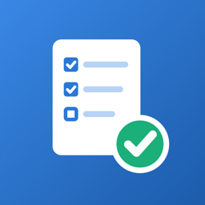
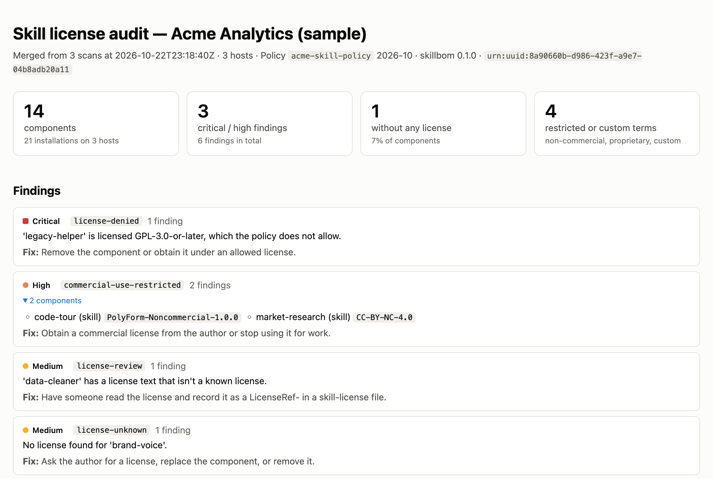

<p align="center"></p>

<h1 align="center">skillbom</h1>

<p align="center"><strong>Know what your AI agent skills are licensed under.</strong><br><sub><code>every skill accounted for.</code></sub></p>

<p align="center">
  <a href="https://github.com/eukgoekoko/skillbom/actions/workflows/test.yml"></a>
  <a href="LICENSE"></a>
  
  
  
</p>

<p align="center">
  <a href="https://eukgoekoko.github.io/skillbom/">Website</a> ·
  <a href="https://eukgoekoko.github.io/skillbom/demo/report.html">Sample report</a> ·
  <a href="docs/teams.md">For teams</a> ·
  <a href="docs/research/corpus-2026-10.md">Research</a> ·
  <a href="docs/license-file.md">License-file spec</a>
</p>

skillbom scans the skills and plugins installed for Claude Code and Codex, works out each one's license, and writes a **Skill BOM** and an **HTML audit report** you can hand to legal. A Skill BOM is a bill of materials: a JSON inventory of every skill and plugin, where it came from, and what it's licensed under, with the evidence for each. It runs locally and uploads nothing.

<a href="https://eukgoekoko.github.io/skillbom/demo/report.html"></a>

## Why

A skill is installed by copying a single folder, but its license usually lives at the root of the repository it came from. In our [scan of 62,704 public skills](docs/research/corpus-2026-10.md), **81% are licensed only through the repository or plugin they came from**, so the installed copy carries none. Hundreds don't permit commercial use, and proprietary skills circulate in popular collections. skillbom tells you which of these are on your machines.

## Quick start

**In Claude Code**

```
/plugin marketplace add eukgoekoko/skillbom
/plugin install skillbom@skillbom
/skillbom:audit
```

You can also just ask *"what licenses are my skills under?"*. Reports are saved to `~/skillbom-reports/<timestamp>/`.

**From the command line**

```sh
pip install git+https://github.com/eukgoekoko/skillbom
skillbom scan -o bom.json --html report.html
```

Both need Python 3.9 or newer.

## What it does

| | |
|---|---|
| **Finds** | User, project, managed and claude.ai-synced skills; installed plugins and the skills inside them; Codex skills; any folder you point it at. |
| **Detects** | Licenses from `skill-license.yaml`, plugin manifests, SKILL.md frontmatter and LICENSE texts, including source-available licenses (PolyForm, BUSL, Elastic, FSL, Commons Clause). Evidence from the skill itself beats inherited evidence, and every result keeps its evidence and a confidence score. |
| **Flags** | Policy violations, licenses that don't permit commercial use, unknown, conflicting and custom licenses, modified copies, and incompatible bundling in plugins. |
| **Reports** | A Skill BOM in JSON and a self-contained HTML report with a fix for every finding. It prints to PDF. |
| **Merges** | `skillbom merge` combines scans from many machines into one organization-wide BOM. |

```sh
skillbom scan --policy policy.yaml              # allowed / denied licenses, severity overrides
skillbom scan --include-catalogs                # also plugins available in marketplaces
skillbom scan --no-home --root DIR              # scan only DIR
skillbom merge a.json b.json -o all.json --html all.html
skillbom report bom.json -o report.html
```

## An open license file for skills

A `skill-license.yaml` next to `SKILL.md` declares the license in a form tools can verify. It uses standard SPDX expressions, commercial offers with machine-readable grants (commercial use, modification, redistribution, bundling, hosted use), a content hash for detecting modified copies, and `includes` for checking license compatibility when plugins bundle other skills.

```yaml
specVersion: "0.1"
subject: { kind: skill, id: lexicon/contract-check, version: 2.1.0 }
license:
  expression: CC-BY-NC-4.0 OR LicenseRef-team
  offers:
    - id: LicenseRef-team
      scope: { licensee: team, seats: 10 }
      term: { type: subscription, durationDays: 365 }
      grants: { commercialUse: true, modify: true, compose: internal-only }
```

See the [license-file spec](docs/license-file.md), the [Skill BOM spec](docs/skill-bom.md), the [scanner reference](docs/scanner.md), the [JSON Schemas](schema/) and the [examples](examples/).

## Repository layout

| Path | Contents |
|---|---|
| `plugins/skillbom/` | The Claude Code plugin: `audit` skill, `bin/skillbom` launcher, and the scanner package in `src/skillbom/` |
| `schema/`, `examples/` | JSON Schemas and example files for both formats |
| `docs/` | Specs, research, and the website (GitHub Pages) |
| `scripts/` | Schema validation, the corpus study pipeline, the sample-report generator |
| `tests/` | Test suite |

## Development

```sh
python3 -m venv .venv && .venv/bin/pip install -r requirements.txt
.venv/bin/pytest                               # tests
.venv/bin/python scripts/validate.py           # validate examples against the schemas
.venv/bin/python scripts/demo/make_demo.py     # regenerate the sample report in docs/demo/
```

## Status

The specs are draft 0.1 and the scanner is a prototype. On a held-out sample of 100 public skills, license detection matched hand labels on every unambiguous case ([accuracy details](docs/research/corpus-2026-10.md#accuracy)). Issues and feedback are welcome.

License categories summarize license texts. They are not legal advice.

## License

[Apache-2.0](LICENSE)
